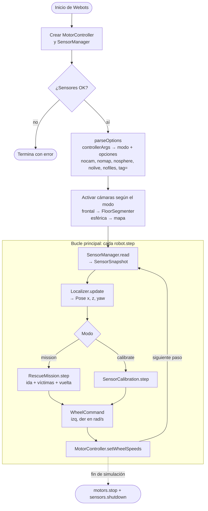
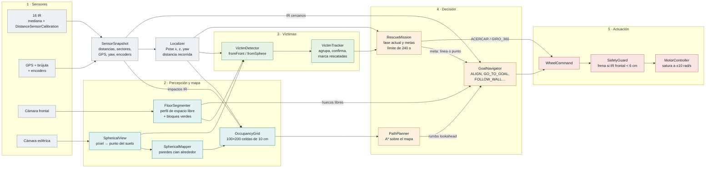
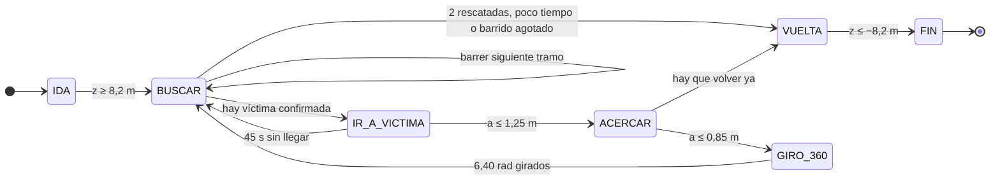

# Diagramas del controlador

Vista gráfica de cómo está construido `controllers/fool_controller/`: qué parte del código depende de cuál y de qué se encarga
cada una. El detalle de cada módulo está en [ARQUITECTURA.md](ARQUITECTURA.md), la lógica de navegación en [NAVEGACION.md](NAVEGACION.md) y la
explicación narrativa del funcionamiento en [FUNCIONAMIENTO.md](FUNCIONAMIENTO.md).

El robot repite un ciclo en cada paso de simulación: leer sensores, estimar dónde está, entender el entorno, decidir qué hacer y
mandar velocidades a las ruedas. Cada parte vive en su propio módulo y los módulos de arriba solo usan a los de abajo.

## 1. Arranque y elección de modo

`fool_controller.cpp` crea motores y sensores, lee los `controllerArgs` del mundo y decide qué módulo toma el control.
El modo por defecto es `mission`; los demás sirven para probar partes sueltas.

## 2. Qué depende de qué en un paso de la misión

Camino de los datos dentro de `RescueMission::step`. Las flechas van del módulo que produce un dato al que lo consume.

Colores: gris = sensores y pose, cian = percepción y mapa, verde = víctimas, amarillo = decisión, rojo = actuación.

Las tres capas de navegación que se ven en el diagrama:

| Capa | Módulos | Qué aporta | Depende de la luz |
|---|---|---|---|
| Memoria y plan | `OccupancyGrid` + `PathPlanner` | Recuerda paredes y callejones; da el camino más corto conocido | No (solo IR + pose) |
| Anticipación | `FloorSegmenter` + `SphericalMapper` | Huecos y paredes a metros de distancia | Sí (se desactivan con poca luz) |
| Reacción | IR en `GoalNavigator` + `SafetyGuard` | Rodea lo que aparece delante, frena en emergencia | No |

Si una capa de arriba falla, la de abajo sigue funcionando.

## 3. Fases de la misión de rescate

`RescueMission` es una máquina de estados. Es el único módulo que conoce las metas, los tiempos y las métricas; el movimiento
fino lo delega en `GoalNavigator`.

1. **IDA**: `GoalNavigator` hacia la línea z = 8,4 m mientras el mapa y el detector de víctimas trabajan en segundo plano.
2. **BUSCAR**: decide si volver, ir a la víctima confirmada más cercana o barrer el pasillo del fondo.
3. **IR_A_VICTIMA** y **ACERCAR**: A* hasta la víctima y luego avance directo hasta quedar a menos de 1 m.
4. **GIRO_360**: gira en el sitio una vuelta completa e imprime el aviso de víctima rescatada.
5. **VUELTA**: navega hacia z = −8,6 m prefiriendo las celdas ya recorridas.
6. **FIN**: escribe `results/mission_results.csv` y el mapa final.

## 4. De qué se encarga cada archivo

| Módulo | Responsabilidad | Usa |
|---|---|---|
| **Entrada** | | |
| `fool_controller.cpp` | Punto de entrada: lee opciones, crea módulos, corre el bucle y elige el modo | todos los de nivel superior |
| `config/RobotConfig.h` | Parámetros principales: velocidades, umbrales, metas, tiempos | nadie (lo usan todos) |
| **Sensores y pose** | | |
| `sensors/SensorManager` | Habilita GPS, brújula, encoders, 16 IR y cámaras; filtra los IR y calcula sectores | `DistanceSensorCalibration` |
| `sensors/DistanceSensorCalibration` | Convierte la respuesta del IR en metros invirtiendo la lookup table | — |
| `sensors/SensorSnapshot.h` | Foto de un paso: lecturas y sectores | `RobotConfig` |
| `localization/Localizer` | Pose: GPS para posición, brújula para orientación; odometría de respaldo | `SensorSnapshot` |
| **Percepción y mapa** | | |
| `perception/FloorSegmenter` | Imagen frontal → distancia libre por columna y bloques verdes | `RobotConfig` |
| `perception/SphericalView.h` | Geometría medida de la cámara esférica: píxel → punto del suelo | — |
| `perception/VictimDetector.h` | Detecta víctimas en ambas cámaras y las sigue con `VictimTracker` | `FloorSegmenter`, `SphericalView`, `Localizer` |
| `mapping/OccupancyGrid.h` | Mapa de ocupación con evidencia de IR; cuenta visitas por celda | `SensorSnapshot`, `Localizer` |
| `mapping/SphericalMapper.h` | Añade al mapa paredes vistas por la cámara esférica | `OccupancyGrid`, `SphericalView` |
| **Decisión** | | |
| `planning/PathPlanner.h` | A* de 8 vecinos hasta una línea o un punto, con margen a paredes | `OccupancyGrid`, `Localizer` |
| `navigation/GoalNavigator` | Máquina de estados de movimiento: alinear, avanzar, rodear obstáculos, recuperarse | `PathPlanner`, `OccupancyGrid`, `FloorSegmenter`, `SensorSnapshot` |
| `mission/RescueMission.h` | Fases de la misión, reglas de tiempo, métricas y CSV de resultados | `GoalNavigator`, mapa, `VictimDetector`, `SafetyGuard` |
| **Actuación** | | |
| `control/WheelCommand.h` | Par de velocidades izquierda/derecha: el idioma común de todos los módulos | — |
| `control/SafetyGuard.h` | Filtro final: anula el avance si un IR frontal ve algo a menos de 6 cm | `SensorSnapshot` |
| `control/MotorController` | Motores en modo velocidad, saturados a ±10 rad/s | `RobotConfig` |
| **Herramientas** | | |
| `calibration/SensorCalibration` | Rutina que mide GPS, brújula, encoders e IR (modo `calibrate`) | `Localizer`, `SensorSnapshot` |
| `common/Angles.h`, `common/RunOutput.h` | Utilidades de ángulos y rutas de salida en `results/` | — |
| `tools/live_map.py` | Visor externo del mapa en directo (lee `results/live_map.txt`) | — |
