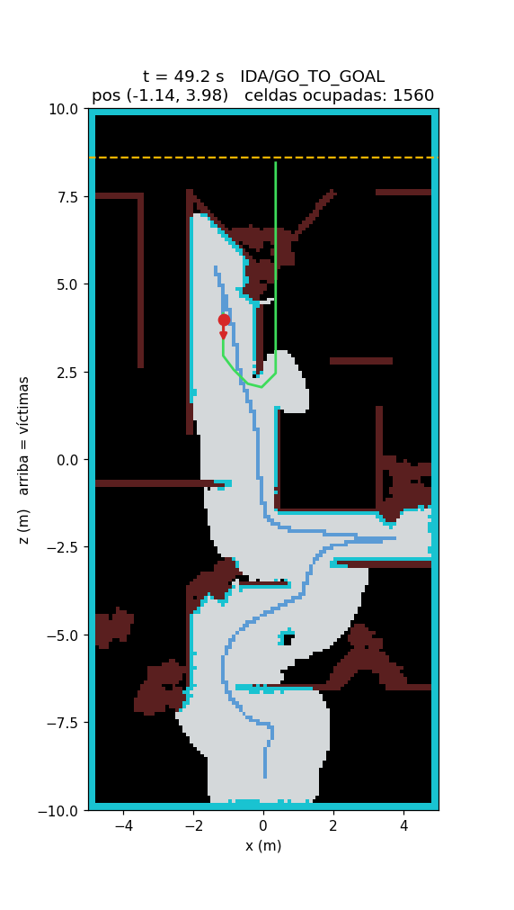
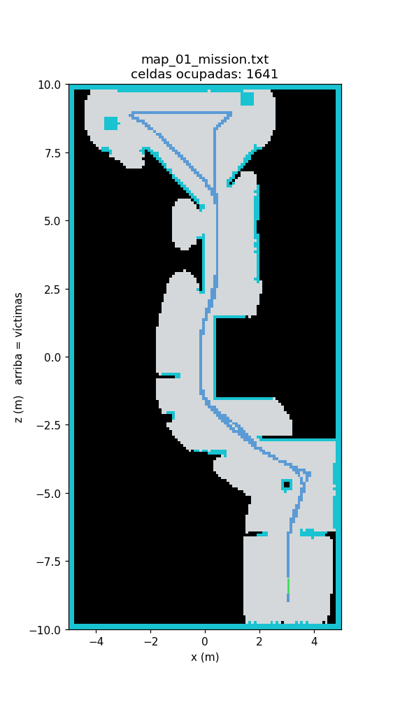

# Cómo funciona el robot de rescate

Explicación completa, de principio a fin, de cómo el Pioneer II cumple la misión: qué sabe por cada sensor, cómo construye el mapa, cómo decide el camino,
cómo se mueve, cómo encuentra a las víctimas y cómo vuelve. Está escrita para entender el sistema, no para modificarlo. Para tocar el código, ver
[ARQUITECTURA.md](ARQUITECTURA.md); para los parámetros, [CONFIGURACION.md](CONFIGURACION.md); para los diagramas, [DIAGRAMAS.md](DIAGRAMAS.md).

## Resumen

El robot no conoce el recinto. En cada paso de simulación lee sus sensores, calcula dónde está y va dibujando un **mapa de ocupación** con lo que detecta.
Sobre ese mapa, un **A\*** calcula el camino más corto conocido hasta la meta. Un **navegador reactivo** sigue ese camino, usa la cámara frontal para ir rápido
por donde hay espacio y los infrarrojos para rodear lo que aparece delante. Por encima, una **máquina de estados de misión** decide qué meta toca
(ir al fondo, ir a una víctima, girar 360°, volver) y vigila el límite de 240 s. Al final, un **filtro de seguridad** frena si va a chocar.

```
sensores → pose → mapa + percepción → plan A* → navegador → seguridad → motores
                                ↑                    ↑
                       víctimas detectadas ──→ misión (elige la meta)
```

## 1. La tarea

- Recinto de **10 × 20 m** (x de −5 a 5, z de −10 a 10) con paredes y obstáculos de color **cian** sobre suelo gris. Hay líneas negras y amarillas en el suelo.
- El robot sale cerca de **z = −9**. Las **dos víctimas** (cilindros **verdes**) están en el fondo del recinto (z > 5).
- Hay que llegar al fondo, encontrar cada víctima, **pararse a menos de 1 m**, **girar 360°** e imprimir un mensaje, y **volver a la salida**. Todo en **240 s**.
- Los 10 mundos cambian la distribución de obstáculos, la **luz** (dos son casi oscuros) y la **niebla**. El controlador es el mismo para todos.

## 2. El ciclo de control

Todo ocurre dentro de un bucle en [fool_controller.cpp](../controllers/fool_controller/fool_controller.cpp) que se repite en cada paso de simulación:

1. **Leer sensores** (`SensorManager::read`) → una "foto" del instante (`SensorSnapshot`).
2. **Estimar la pose** (`Localizer::update`) → posición (x, z) y orientación (yaw).
3. **Procesar la cámara frontal** (`FloorSegmenter::process`) → espacio libre por delante y manchas verdes.
4. **Paso de la misión** (`RescueMission::step`), que a su vez:
   - actualiza el mapa con los IR y, cada 2 pasos, con la cámara esférica;
   - busca víctimas en las dos cámaras;
   - comprueba el tiempo;
   - ejecuta la fase actual, que normalmente pide al navegador un comando de ruedas;
   - pasa el comando por el filtro de seguridad.
5. **Mandar el comando** (`MotorController::setWheelSpeeds`).

El resultado de cada paso es siempre un `WheelCommand`: dos velocidades (rueda izquierda y derecha, en rad/s). Es el idioma común de todos los módulos.

## 3. Qué aporta cada sensor

| Sensor | Qué mide | Alcance | Para qué se usa | ¿Depende de la luz? |
|---|---|---|---|---|
| 16 infrarrojos (ds0–ds15) | Distancia a lo que tiene delante cada uno | ~0,19 m fiable | Mapa (con mucho peso), detectar choques, seguir paredes, freno de emergencia | No |
| GPS | Posición (x, z) | — | Pose | No |
| Brújula | Orientación (yaw) | — | Pose | No |
| Encoders de las ruedas | Giro de cada rueda | — | Odometría de respaldo, detectar atascos | No |
| Cámara frontal (`camera_f`) | Imagen hacia delante | hasta 3,5 m | Elegir rumbo y velocidad, ver víctimas a lo lejos | Sí |
| Cámara esférica (`camera_s`) | Imagen 360° del suelo alrededor | 0,5–1,6 m (mapa), 0,7–3 m (víctimas) | Mapa (con poco peso), ver víctimas alrededor | Sí |

La idea de diseño es que **lo imprescindible no dependa de la luz**: IR, GPS y brújula bastan para llegar y volver. Las cámaras hacen al robot más rápido y le
permiten ver las víctimas, pero si la imagen está demasiado oscura se ignoran y el robot sigue funcionando con lo demás.

## 4. Saber dónde está (localización)

[Localizer](../controllers/fool_controller/localization/Localizer.cpp):

- **Posición:** del GPS. Si el GPS no da un valor válido, se usa **odometría**: lo que han girado las ruedas (radio 0,0825 m) combinado con la orientación de la brújula.
- **Orientación:** de la brújula.
- Además lleva cuentas para diagnóstico: odometría pura, distancia total recorrida y giro acumulado.
- La misión no empieza hasta tener la primera lectura válida de GPS, brújula y encoders.

Toda la información de los sensores (un impacto de IR, un píxel de la cámara) se traduce a coordenadas del mundo con esta pose. Por eso el mapa es coherente:
una pared vista dos veces desde sitios distintos cae en la misma celda.

## 5. Percepción: interpretar lo que ven los sensores

### 5.1 Infrarrojos

[SensorManager](../controllers/fool_controller/sensors/SensorManager.cpp) y [DistanceSensorCalibration](../controllers/fool_controller/sensors/DistanceSensorCalibration.cpp):

1. Cada IR devuelve un valor de respuesta, no una distancia. Se filtra con una **mediana de las 3 últimas lecturas** para quitar picos de ruido.
2. Se convierte a metros **invirtiendo la tabla del sensor** (interpolación lineal) y corrigiendo por la **reflectividad del cian** (factor 0,52).
3. Se marca si está **saturado**: demasiado cerca para medir exacto; en ese caso la distancia es solo un máximo.
4. Se agrupan en **sectores** (`front`, `left`, `right`, `rearLeft`…), que dan la distancia mínima de un grupo de sensores. El navegador razona con sectores,
   no con sensores sueltos.

### 5.2 Cámara frontal: ¿cómo sabe qué está libre?

[FloorSegmenter](../controllers/fool_controller/perception/FloorSegmenter.cpp) responde a la pregunta *"¿cuántos metros libres hay en cada dirección delante de mí?"*.

1. **Aprende el color del suelo en esa imagen.** Toma la mediana del color de la franja inferior (8 % de abajo, mitad central), que es el suelo justo delante del robot.
   Si es demasiado oscuro (brillo < 12/255), la imagen se declara **no válida** y no se usa.
2. **Clasifica cada píxel comparándolo con ese suelo**, con proporciones de color (verde/rojo, azul/rojo, verde/azul) y no con valores absolutos.
   Así funciona igual con mucha o poca luz:
   - verde y azul un 15 % por encima del suelo → **obstáculo** (cian);
   - verde un 35 % por encima de rojo y azul (y suficientemente brillante) → **víctima**;
   - casi negro → **desconocido**;
   - lo demás → **suelo** (incluye las líneas negras y amarillas y las sombras).
3. **Recorre ~60 columnas de la imagen de abajo hacia el horizonte.** Mientras hay suelo, ese tramo está libre. Donde aparecen 2 píxeles seguidos que no son suelo,
   ahí termina el espacio libre de esa dirección.
4. **Pasa la fila a metros con geometría de suelo plano.** La cámara está a 0,255 m de altura y mira horizontal: cuanto más abajo en la imagen, más cerca está ese punto
   del suelo (`distancia = altura × focal / píxeles por debajo del horizonte`). La columna da el ángulo.
5. **No se fía de lo lejano:** más allá de 3,5 m (niebla) no da nada por libre.

El resultado es un **perfil de espacio libre**. Con él, `corridorClearance(rumbo)` dice cuánto puede avanzar el robot en un pasillo de su ancho (±0,30 m) hacia un rumbo dado.

> **Importante:** la cámara frontal **no escribe en el mapa**. Se usa en el momento para elegir rumbo y velocidad, y para detectar víctimas. Lo que ve se vuelve a ver
> en la siguiente imagen; no se guarda.

### 5.3 Cámara esférica

Está montada a 0,44 m de altura mirando al suelo y ve 360° alrededor. Su geometría (dónde cae cada punto del suelo en la imagen, qué parte tapa el propio robot) se
**midió con capturas reales de Webots** y está en [SphericalView.h](../controllers/fool_controller/perception/SphericalView.h). Se usa para dos cosas:

- **Mapa:** paredes a 0,5–1,6 m en todas direcciones, también a los lados y detrás (sección 6.3).
- **Víctimas:** manchas verdes a 0,7–3 m alrededor (sección 5.4).

Si el suelo se ve más oscuro de 25/255, la imagen se descarta.

### 5.4 Víctimas

[VictimDetector.h](../controllers/fool_controller/perception/VictimDetector.h):

1. **Observaciones.** En cada imagen se generan posibles víctimas:
   - *Cámara frontal:* cada grupo de columnas verdes da una observación en el punto de la **base** del cilindro (lo único que toca el suelo, así que su distancia
     se puede calcular). Se aceptan de 1 a 6 m.
   - *Cámara esférica:* el píxel verde más cercano en cada dirección (intervalos de 3°) da la base; el centro se estima 0,3 m más allá (el radio del cilindro). De 0,7 a 3 m.
2. **Seguimiento (`VictimTracker`).** Las observaciones se pasan a coordenadas del mundo y se agrupan: dos observaciones a menos de 0,5 m son la misma víctima.
   La posición es una media ponderada en la que las observaciones lejanas pesan muy poco (el peso cae con la distancia al cubo) y las **cercanas (< 1,7 m) mandan**.
3. **Confirmación.** Una candidata pasa a **confirmada** cuando se ha visto en **5 imágenes**. Así un reflejo verde aislado no manda al robot a por nada.
4. Se fusionan candidatas duplicadas, se ignoran "ecos" detrás de una víctima ya vista de cerca, y se recuerda cuáles están **rescatadas** o **fallidas**.
5. **Tras cada rescate**, las candidatas pendientes a menos de 1 m de la rescatada que no se vieron durante el giro de 360° se descartan como **duplicadas**:
   en el giro las cámaras miran todo alrededor, así que si allí hubiera otra víctima real la habrían visto. Sin esta regla, una víctima estimada dos veces
   (una desde lejos con error y otra de cerca) se "rescataba" dos veces.
6. Al elegir la siguiente víctima:
   - Una candidata a **menos de 0,6 m** de una rescatada se descarta: dos cilindros de 0,3 m de radio no pueden estar más juntos, así que es la misma.
   - Las que están a **menos de 1 m** van **al final de la cola**: si hay otra confirmada más lejos, se va primero a por esa. Si no queda otra (dos víctimas
     reales muy juntas, como en s10), se elige la más alejada de la rescatada, que es la que con más probabilidad es otra víctima.

## 6. El mapa de ocupación

[OccupancyGrid.h](../controllers/fool_controller/mapping/OccupancyGrid.h) es la **memoria** del robot.

### 6.1 Estructura

- Cuadrícula de **100 × 200 celdas de 10 cm**, que cubre todo el recinto.
- Cada celda guarda un número entero de **evidencia**, entre −20 y +40:
  - **0** = desconocida (estado inicial);
  - **negativa** = hay pruebas de que está libre;
  - **≥ 10** = **ocupada**.
- Las paredes exteriores se marcan como ocupadas desde el principio y no se pueden borrar.
- Además, cada celda cuenta cuántas veces ha **entrado el robot** en ella.

### 6.2 Con los infrarrojos (cada paso)

1. **Huella del robot:** las celdas a menos de 15 cm de su centro se ponen a −20. Si el robot está ahí, está libre.
2. **Un rayo por cada IR.** Con la posición y el ángulo de cada sensor en el chasis y la pose del robot, se traza su rayo en el mundo:
   - las celdas que el rayo **atraviesa sin chocar** restan **1** → evidencia de libre;
   - si detecta algo a menos de 0,19 m, la celda del **impacto** (3 cm más allá de la superficie medida) suma **+6** → evidencia de ocupado.
3. Una celda pasa a **ocupada al llegar a 10**: hacen falta **dos impactos**. Un pico de ruido aislado no crea una pared, y una pared real solo se borra si varios
   rayos la atraviesan después sin chocar.

### 6.3 Con la cámara esférica (cada 2 pasos)

[SphericalMapper.h](../controllers/fool_controller/mapping/SphericalMapper.h):

1. Lanza **90 rayos** (uno cada 4°) sobre el suelo, de 0,5 a 1,6 m, en pasos de 5 cm.
2. Para cada punto del suelo calcula **en qué píxel debería verse** y mira su color:
   - **gris (suelo)** → ese punto está libre; resta, pero solo en celdas sin evidencia de ocupación (**la cámara nunca borra lo que vieron los IR**);
   - **primer cian**, tras al menos 3 puntos de suelo → hay una **pared** entre el último suelo y ese punto; suma **+4** (≤ 1 m) o **+2** (más lejos) y el rayo termina;
   - **verde** → víctima, no pared.
3. Como la cámara suma poco, una pared vista solo por ella necesita varias imágenes seguidas para llegar a 10.

### 6.4 Resumen: ¿cómo sabe que hay pared y que está libre?

| | Pared | Libre |
|---|---|---|
| Infrarrojos | El sensor devuelve una distancia corta (< 0,19 m) | El rayo llega a su alcance sin detectar nada |
| Cámara esférica | El suelo gris pasa a cian | Se ve suelo gris |
| Robot | — | Las celdas bajo el propio robot |

Ninguna lectura sola decide: la evidencia **se acumula** y solo cuenta cuando pasa el umbral.

### 6.5 Otros usos del mapa

- Cuando se rescata una víctima, se marca como un **disco ocupado** de 0,3 m para que la vuelta la rodee.
- El mapa tiene un número de **versión** que cambia cada vez que una celda pasa de libre a ocupada o al revés; el navegador lo usa para saber cuándo replanificar.

## 7. Planificación: el camino con A\*

[PathPlanner.h](../controllers/fool_controller/planning/PathPlanner.h) busca el camino más corto **sobre el mapa** desde la celda del robot hasta la meta.

- **Metas:** una **línea** (cualquier celda con z ≥ 8,4 en la ida, o z ≤ −8,6 en la vuelta) o un **punto** (cualquier celda a menos de cierto radio de una víctima).
- **Vecinos:** 8 direcciones; no corta esquinas entre dos celdas ocupadas.
- **Optimista:** lo **desconocido cuenta como libre**. El robot planifica a través de zonas que no ha visto; si al llegar descubre una pared, el mapa cambia y se replanifica.
  Así no necesita explorar antes de moverse.
- **Celdas prohibidas:** a menos de **0,25 m** de una celda ocupada el robot no cabe, así que no se planifica por ahí.
- **Costes extra** para que el camino sea razonable, no solo corto:
  - hasta **0,08 m por celda** cerca de obstáculos (radio 0,5 m) → prefiere ir por el **centro** de los pasos;
  - **0,04 m por cada visita previa** (hasta 5) → en la ida **evita repetir callejones** ya recorridos;
  - en la **vuelta** se invierte: las celdas **no** recorridas cuestan 0,06 m más → prefiere **volver por donde vino**, porque sabe que por ahí cabe.
- **Heurística:** la distancia que falta hasta la línea o hasta el punto.
- **Replanificación:** cada 0,3 s, y además cada vez que cambia el mapa (como mucho cada 0,1 s). En una ida típica son entre 190 y 500 planes.

Del plan, el navegador solo necesita una cosa: el **rumbo hacia el punto de mira** (`lookaheadYaw`), que es el punto más lejano de la ruta a ≤ 0,8 m que se ve
en línea recta sin atravesar celdas ocupadas. Seguir ese punto suaviza la ruta en escalera de la cuadrícula.

Si no existe ningún camino (`plan=NO` en consola), el navegador vuelve temporalmente a ir recto hacia la meta.

## 8. Navegación: cómo se mueve

[GoalNavigator](../controllers/fool_controller/navigation/GoalNavigator.cpp) convierte "quiero ir hacia aquí" en velocidades de rueda. Trabaja con un único dato
de dirección, **el ángulo entre hacia dónde mira el robot y hacia dónde debe ir**, que sale del plan A\*. Es una máquina de estados:

| Estado | Qué hace | Cuándo sale |
|---|---|---|
| `ALIGN` | Gira en el sitio hacia la meta | Cuando el error es < ~17° → `GO_TO_GOAL` |
| `GO_TO_GOAL` | Avanza corrigiendo el rumbo | Obstáculo delante → `FOLLOW_WALL`; error > 60° → `ALIGN` |
| `FOLLOW_WALL_L` / `_R` | Rodea el obstáculo con la pared a la izquierda / derecha (algoritmo tipo Bug) | Ha progresado y la meta está libre → `GO_TO_GOAL`/`ALIGN` |
| `REVERSE_OUT` | Retrocede para salir de una cuña | → `TURN_AROUND` |
| `TURN_AROUND` | Media vuelta para rodear por el otro lado | → `FOLLOW_WALL` del otro lado |
| `RECOVER` | Sale de un atasco: retrocede y gira hacia el lado con más espacio | → `FOLLOW_WALL` o `ALIGN` |

### En `GO_TO_GOAL`

1. **¿Hay obstáculo?** IR frontal < 18 cm, diagonal < 15 cm, o paso más estrecho que el robot → pasa a rodear.
2. **Rumbo y velocidad:**
   - *Sin cámara válida:* rumbo = meta; velocidad fija de 4 rad/s (~0,33 m/s).
   - *Con cámara:* prueba rumbos de ±20° alrededor de la meta y elige el más cercano a ella que tenga **al menos 2 m libres**. La velocidad sube de 2,5 a 8 rad/s
     (~0,66 m/s) según el espacio libre. Así esquiva obstáculos **antes** de llegar a ellos.
   - Si algún IR delantero detecta algo, la velocidad baja a 2,5 rad/s.
3. **Repulsión lateral:** si hay algo a menos de 14 cm a un lado, se aparta.

### En `FOLLOW_WALL`

- **Elige el lado** por este orden: el lado por el que pasa el plan A\*; el lado donde la cámara vio un hueco; el lado más despejado; hacia el centro del recinto;
  hacia la meta.
- Mantiene **15 cm** de la pared y se mantiene **paralelo** a ella con los IR laterales.
- Gestiona esquinas interiores (gira), exteriores (sigue recto y luego curva hacia la pared) y cuñas (retrocede).
- **Suelta la pared** cuando ha avanzado hacia la meta y la dirección de la meta está libre (IR y, si hay, cámara). Con plan, si el plan pide ir hacia atrás
  (callejón), deja la pared y sigue el plan.

### Detalles que evitan problemas

- **Detector de atasco:** cada 1,5 s compara lo que ordenó con lo que pasó. Si mandó avanzar y se movió menos de 3 cm, o mandó girar y no giró, entra en `RECOVER`.
- **Giro seguro (`safePivot`):** el Pioneer sobresale por detrás del eje y al girar en el sitio la cola barre hacia un lado. Antes de girar mira los IR traseros
  de ese lado y, si están pegados a algo, hace una maniobra corta para separarse.

## 9. La misión: qué meta toca en cada momento

[RescueMission.h](../controllers/fool_controller/mission/RescueMission.h) es la máquina de estados de más alto nivel. Es el único módulo que conoce las metas,
los tiempos y las métricas. El movimiento lo delega en el navegador.

| Fase | Qué hace | Termina cuando |
|---|---|---|
| `IDA` | Navegar hacia la línea z = 8,4. Mientras tanto, el mapa y el detector de víctimas trabajan. | z ≥ 8,2 |
| `BUSCAR` | Decide: volver, ir a la víctima confirmada más cercana o barrer el fondo | Elige una de las otras fases |
| `IR_A_VICTIMA` | A\* hasta 1,15 m de la víctima (sin cámara en el navegador: la víctima es la meta, no un obstáculo) | A ≤ 1,25 m; se abandona a los 45 s |
| `ACERCAR` | Avance directo hasta 0,85 m del centro de la víctima; retrocede si está a < 0,7 m | A ≤ 0,85 m, IR frontal < 12 cm o 15 s |
| `GIRO_360` | Gira en el sitio hasta acumular 6,40 rad (360° y un margen) e imprime `[VICTIMA n]` | Giro completo → rescatada; 8 s sin completarlo → fallida |
| `VUELTA` | Navegar hacia z = −8,6, prefiriendo el camino ya andado | z ≤ −8,2 → `FIN` |

**Reglas de `BUSCAR`:**
1. Si ya hay **2 rescatadas** → `VUELTA`.
2. Si **no queda tiempo** → `VUELTA`. "No queda tiempo" significa que
   `tiempo transcurrido + (0,55 × tiempo de ida + 12 s) + 12 s de margen > 240 s`; es decir, se estima que volver cuesta algo más de la mitad que ir
   (porque ya hay mapa) y se deja un margen.
3. Si hay una **víctima confirmada** pendiente → `IR_A_VICTIMA` hacia la más cercana.
4. Si no, **barre el pasillo del fondo** (z = 8,9) hacia x = ±3,8 y x = 0; cada tramo caduca a los 30 s. En cada extremo lateral (el robot llega a x ≈ ±3,2) da una
   **vuelta completa en el sitio** para que las cámaras miren la esquina, donde suelen quedar víctimas. No la repite si acaba de dar
   el giro de rescate de 360° a menos de 1 m de ahí. Si acaba el barrido sin víctimas → `VUELTA`.

Tras rescatar una víctima, se marca en el mapa como obstáculo y se vuelve a `BUSCAR`.

**Salidas:** mensajes `[MISION]`, `[VICTIMA]` y `[RESULT]` en consola; una fila en `results/mission_results.csv`; el mapa final en `results/map_<mundo>_mission.txt`;
y el mapa en directo en `results/live_map.txt`.

## 10. Seguridad y motores

- **[SafetyGuard](../controllers/fool_controller/control/SafetyGuard.h):** último filtro antes de los motores. Si un IR frontal ve algo a **menos de 6 cm** y el comando
  quiere avanzar, le quita la componente de avance. El robot puede seguir girando o retrocediendo. Cuenta cuántas veces intervino.
- **[MotorController](../controllers/fool_controller/control/MotorController.cpp):** pone los motores en modo velocidad y limita cada rueda a ±10 rad/s.

## 11. Qué pasa cuando algo falla

El sistema está hecho por **capas**, de la más "inteligente" a la más reactiva. Si una falla, la de abajo sigue:

| Capa | Módulos | Si falla… |
|---|---|---|
| Memoria y plan | Mapa + A\* | Sin plan, el navegador va recto a la meta y rodea con los IR (Bug) |
| Anticipación | Cámara frontal + esférica | Con poca luz se desactivan solas; el robot va más lento y descubre las paredes al tocarlas con los IR |
| Reacción | IR en el navegador + `SafetyGuard` | No depende de la luz ni del mapa; siempre está |

Por eso el robot completa los mundos casi oscuros (02 y 03), aunque más despacio. La cámara esférica es la que más se nota: sin ella, la ida en s03 y s07 tarda
un 45 % y un 65 % más.

## 12. Resultados

Última tanda de la misión completa en Webots (17-11-2026), un intento por mundo (detalle en [RESULTADOS.md](RESULTADOS.md)):

- **10/10 misiones completas**: los 10 robots volvieron a la salida antes de 240 s y rescataron las dos víctimas.
- **20/20** rescates verificados contra la posición real de las víctimas: el robot giró siempre a 0,69–0,83 m de una víctima real, y nunca dos veces de la misma.
- Tiempo total medio **129,4 s** (mínimo 96,1 s en s04, máximo 199,3 s en s03, el más oscuro, con 40,7 s de margen).

"Vuelta a tiempo" y "víctimas" se miden por separado: un robot podría volver a tiempo sin víctimas, porque la misión prioriza volver antes de 240 s (sección 9,
regla de tiempo). La simulación es determinista: repetir la tanda con el mismo código da las mismas cifras.

## 13. Verlo en directo

El controlador escribe el mapa en `results/live_map.txt` cada 0,5 s. El visor lo dibuja:

```bash
python3 tools/live_map.py --world worlds/final_scenario10.wbt
```

- **Negro:** sin descubrir. **Gris claro:** libre. **Azul:** por donde pasó el robot. **Cian:** pared vista.
- **Línea verde:** plan A\* actual. **Línea amarilla:** meta. **Punto y flecha rojos:** el robot.
- **Rojo oscuro** (solo con `--world`): paredes reales del mundo que el robot aún no ha visto. El número del `.wbt` tiene que coincidir con el mundo abierto en Webots.

Escenario 10 a los 49 s de la ida: el robot ha descubierto el camino desde la salida; el resto sigue negro y el plan A\* (verde) atraviesa zona desconocida porque la
considera libre.



Mapa final del escenario 01 (`--map results/map_01_mission.txt`): ida, búsqueda en el fondo y vuelta. Los dos cuadrados cian del fondo son las víctimas rescatadas,
marcadas como obstáculo.



## Para saber más

| Tema | Documento |
|---|---|
| Diagramas de flujo y dependencias | [DIAGRAMAS.md](DIAGRAMAS.md) |
| Cada módulo, qué recibe y qué entrega | [ARQUITECTURA.md](ARQUITECTURA.md) |
| La máquina de estados de navegación en detalle | [NAVEGACION.md](NAVEGACION.md) |
| Todos los parámetros | [CONFIGURACION.md](CONFIGURACION.md) |
| Calibración de los sensores | [CALIBRACION.md](CALIBRACION.md) |
| Resultados y CSV | [RESULTADOS.md](RESULTADOS.md) |
